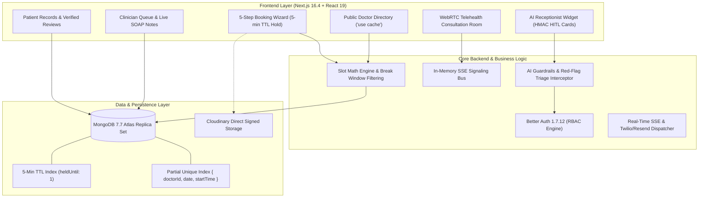
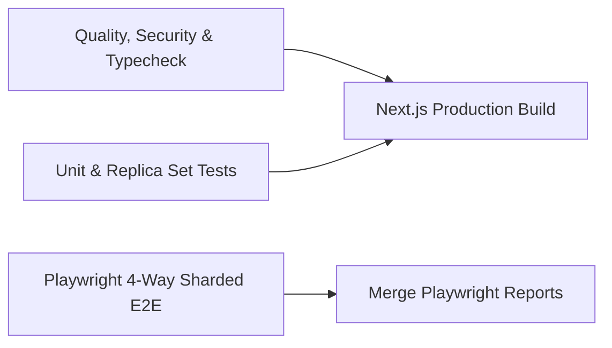

# Digital Clinic & Healthcare Appointment System

[](https://github.com/shah-zaib-nawaz/digital-clinic/actions/workflows/ci-cd.yml)
[](https://github.com/shah-zaib-nawaz/digital-clinic)
[](https://opensource.org/licenses/MIT)
[](https://en.wikipedia.org/wiki/Health_Insurance_Portability_and_Accountability_Act)
[](https://nextjs.org/)
[](https://react.dev/)
[](https://www.typescriptlang.org/)
[](https://tailwindcss.com/)
[](https://www.mongodb.com/)
[](https://better-auth.com/)
[-black?style=flat)](https://sdk.vercel.ai/)
[](https://vitest.dev/)
[](https://playwright.dev/)

An enterprise-grade outpatient clinical scheduling, telehealth, electronic health records (EHR), and conversational triage platform engineered with high-concurrency ACID transactions, cryptographic Human-in-the-Loop safeguards, and HIPAA compliance governance.

---

## 🏛️ System Architecture



---

## 🚀 Key Technical Capabilities

### 1. Concurrency-Safe 5-Minute Slot Reservation Lock
- **Atomic 5-Minute Reservation Lock**: When a patient selects an appointment slot, MongoDB atomically claims it (`status: 'held'`) with a native TTL index on `heldUntil`. If abandoned, the slot automatically expires and frees up in exactly 300 seconds.
- **Double-Booking Immunity**: Enforced via a compound partial unique index `{ doctorId: 1, date: 1, startTime: 1 }` filtering `{ status: { $in: ['held', 'pending', 'confirmed'] } }`. Verified under 10-thread simultaneous race tests (`E11000` isolation).
- **Atomic Multi-Slot Rescheduling**: Executed inside `connection.withTransaction()`; if destination slot is claimed, the transaction aborts cleanly, safeguarding the original booking.

### 2. Autonomous Clinical AI Receptionist with HMAC Guardrails
- **Vercel AI SDK v7 (`ai@7.0.148`)**: Powered by OpenAI `gpt-4o` with `toolCallConcurrency: 1` to strictly serialize clinical tool side-effects.
- **HMAC-SHA256 Human-in-the-Loop (HITL) Cards**: The AI cannot mutate appointment states unilaterally. Every slot hold generates a tamper-evident cryptographic token (`timingSafeEqual`) requiring direct patient click authorization with a 10-minute expiry window.
- **Emergency Red-Flag Interceptor**: Automated interception of acute presentations (cardiac, stroke, dyspnea, hemorrhage, anaphylaxis, suicide). Halts booking and issues prominent 911 emergency directives.
- **Daily Budget Circuit Breaker**: Evaluates daily clinic token spend (`checkClinicAIBudgetAndRateLimit`); trips smoothly if cap is reached and deep-links patients to the 5-step booking wizard.

### 3. Electronic Health Records (EHR) & Sealed SOAP Notes
- **SOAP Standard**: Subjective, Objective (vitals), Assessment (ICD-10 search), and Plan (prescriptions with refills and regimens).
- **Cryptographic Signature Sealing**: Once finalized by the physician, the note is sealed with an SHA-256 signature hash and timestamp, transitioning the appointment to `completed`.
- **Verified Reviews & Rating Aggregation**: Only completed appointments permit patient reviews. Admin approval triggers a MongoDB aggregation pipeline recalculating `Doctor.averageRating` and `Doctor.reviewCount`.

### 4. WebRTC Telehealth Consultation Suites
- **Sub-50ms Video Rooms**: Peer connection utilizing Google STUN relays.
- **Zero-Dependency SSE Signaling**: In-memory event bus on `globalThis` connected to authenticated `/api/telehealth/signal` SSE streams.
- **Clinician Cockpit**: Split-screen live video consultation with concurrent SOAP charting and real-time in-call text chat.

---

## 🔑 Pre-Seeded Demo Credentials

All accounts share the default development password: **`Password123!`**

| Role | Email Address | Password | Direct Portal Route | Capabilities |
| :--- | :--- | :--- | :--- | :--- |
| **Patient** | `patient@clinic.test` | `Password123!` | [`/patient`](http://localhost:3000/patient) | Browse doctors, 5-min TTL booking, telehealth room, view EHR notes |
| **Doctor (General)** | `doctor@clinic.test` | `Password123!` | [`/doctor`](http://localhost:3000/doctor) | Daily queue, author/seal SOAP notes, manage availability |
| **Doctor (Cardiology)** | `sarah.jenkins@digitalclinic.org` | `Password123!` | [`/doctor`](http://localhost:3000/doctor) | Cardiology outpatient schedule, patient clinical history |
| **Doctor (Dermatology)** | `elena.rostova@digitalclinic.org` | `Password123!` | [`/doctor`](http://localhost:3000/doctor) | Dermatology outpatient schedule, patient clinical history |
| **Admin** | `admin@clinic.test` | `Password123!` | [`/admin`](http://localhost:3000/admin) | Doctor management, department setup, review moderation |
| **Superadmin** | `superadmin@clinic.test` | `Password123!` | [`/admin`](http://localhost:3000/admin) | Full system administration, AI telemetry, audit logs |

---

## 🗺️ Application Route Matrix (26 Verified Routes)

| Category | Route | Access Level | Description |
| :--- | :--- | :--- | :--- |
| **Public** | `/` | Anonymous | Dynamic homepage with search, metrics, faculty, and role sandbox |
| **Public** | `/doctors` | Anonymous | Searchable physician directory with specialty filters & sort |
| **Public** | `/doctors/[id]` | Anonymous | Physician profile, accepted insurance, reviews, and slots |
| **Public** | `/privacy` | Anonymous | HIPAA & GDPR privacy policy and patient rights |
| **Public** | `/terms` | Anonymous | Terms of clinical service and telehealth consent |
| **Public** | `/ai-disclaimer` | Anonymous | Non-diagnostic AI triage limitations & 911 emergency notice |
| **Auth** | `/auth/sign-in` | Anonymous | Better Auth credentials sign-in with redirect callback |
| **Auth** | `/auth/sign-up` | Anonymous | Patient registration with auto-provisioned intake profile |
| **Patient** | `/patient` | Patient Role | Patient dashboard overview and upcoming appointments |
| **Patient** | `/patient/book` | Patient Role | 5-step concurrency-safe booking wizard |
| **Patient** | `/patient/appointments` | Patient Role | Patient appointment management, cancellations & rescheduling |
| **Patient** | `/patient/records` | Patient Role | Sealed SOAP clinical visit notes & digital prescriptions |
| **Patient** | `/patient/telehealth/[id]` | Patient Role | WebRTC telehealth patient waiting room & consultation suite |
| **Doctor** | `/doctor` | Doctor Role | Doctor cockpit, today's patient queue, and appointment status |
| **Doctor** | `/doctor/schedule` | Doctor Role | Recurring weekly availability, slot duration, and break rules |
| **Doctor** | `/doctor/notes` | Doctor Role | Sealed SOAP visit notes archive and patient search |
| **Doctor** | `/doctor/appointments/[id]/notes` | Doctor Role | Live SOAP clinical note authoring workspace & ICD-10 search |
| **Doctor** | `/doctor/telehealth/[id]` | Doctor Role | Doctor telehealth room with concurrent clinical charting |
| **Doctor** | `/doctor/patients` | Doctor Role | Patient roster with historical visits & medical intakes |
| **Doctor** | `/doctor/reviews` | Doctor Role | Patient feedback and ratings breakdown |
| **Admin** | `/admin` | Admin Role | Operations analytics, appointment stats, and provider counts |
| **Admin** | `/admin/doctors` | Admin Role | Physician directory management and status controls |
| **Admin** | `/admin/doctors/new` | Admin Role | Onboard new credentialed physician profile |
| **Admin** | `/admin/departments` | Admin Role | Medical department CRUD with icon selector & descriptions |
| **Admin** | `/admin/reviews` | Admin Role | Patient review moderation queue & rating recalculation |
| **Admin** | `/admin/ai-telemetry` | Admin Role | AI token spend, guardrails deflection metrics & safety audit |

---

## 🛠️ Quick Start & Local Setup

### Prerequisites
- **Node.js**: `22.x` (LTS) or `24.x`
- **pnpm**: `10.x` or `11.x`
- **MongoDB**: `7.7.x` Replica Set (or MongoDB Atlas)

### 1. Clone Repository
```bash
git clone https://github.com/shah-zaib-nawaz/digital-clinic.git
cd digital-clinic
```

### 2. Install Dependencies
```bash
pnpm install --frozen-lockfile
```

### 3. Configure Environment Variables
Create `.env.local` in the project root:
```env
# Database (MongoDB 7.7 Replica Set or MongoDB Atlas)
MONGODB_URI="mongodb+srv://<user>:<password>@cluster0.mongodb.net/digital_clinic?retryWrites=true&w=majority"

# Better Auth 1.7.12
BETTER_AUTH_SECRET="generate-a-64-character-hex-secret-here"
BETTER_AUTH_URL="http://localhost:3000"

# AI Receptionist (Vercel AI SDK v7 & OpenAI gpt-4o)
OPENAI_API_KEY="sk-proj-..."
AI_HMAC_SECRET="generate-a-separate-32-character-hmac-secret-for-tool-approvals"
AI_DAILY_SPEND_CAP_USD="50.0"

# Cloudinary Direct Signed Media Ingestion (Optional)
NEXT_PUBLIC_CLOUDINARY_CLOUD_NAME="your-cloud-name"
NEXT_PUBLIC_CLOUDINARY_API_KEY="your-api-key"
CLOUDINARY_API_SECRET="your-api-secret"

# Transactional Communications (Resend & Twilio) (Optional)
RESEND_API_KEY="re_..."
EMAIL_FROM="Digital Clinic <notifications@yourdomain.com>"
ENABLE_TWILIO_SMS="false"
```

### 4. Seed Database
```bash
# Seed auth accounts (patient, doctor, admin, superadmin)
pnpm exec tsx scripts/seed-auth-users.ts

# Seed 6 departments, 12 doctors, and 7-day availability slots
pnpm exec tsx scripts/seed-clinic.ts
```

### 5. Launch Development Server
```bash
pnpm dev
```
Open [http://localhost:3000](http://localhost:3000) in your browser.

---

## 🧪 Comprehensive Verification Suite

Run all quality checks locally:

```bash
# 1. Supply-Chain & Lockfile Integrity Check
pnpm verify:supply-chain

# 2. TypeScript 7.0 Typecheck
pnpm typecheck

# 3. Code Quality & Linting
pnpm lint

# 4. Vitest Unit Test Suite (53 tests across 4 domain suites)
pnpm test:unit

# 5. 50-Case Adversarial AI Safety & Emergency Triage Benchmark
pnpm eval:ai-safety

# 6. MongoDB Replica Set ACID Transactions & Concurrency Race Suite
pnpm test:integration

# 7. Playwright E2E & WebMCP Agent Tests
pnpm test:e2e

# 8. Full 26-Route Automated HTTP Probe
pnpm exec tsx scripts/probe-all-routes.ts

# 9. Next.js 16.4 Turbopack Production Build
pnpm build
```

---

## ⚙️ GitHub Actions CI/CD Pipeline

The automated CI/CD pipeline (`.github/workflows/ci-cd.yml`) executes on every `push` and `pull_request` to the `main` branch across 5 parallel stages:



1. **Stage 1 (Quality & Security)**: Validates `.npmrc` trust policy, locks down dependency integrity with `verify:supply-chain`, runs ESLint, and executes `tsgo --noEmit`.
2. **Stage 2 (Unit & Integration)**: Runs all 53 Vitest unit tests, the 50-case adversarial AI safety benchmark, and MongoDB replica-set transaction tests with `mongodb-memory-server`.
3. **Stage 3 (Sharded E2E)**: Runs Playwright across 4 matrix shards (`1/4`, `2/4`, `3/4`, `4/4`) with a dedicated MongoDB 7 service container.
4. **Stage 4 (Report Merge)**: Aggregates shard blob artifacts into an interactive unified Playwright HTML report.
5. **Stage 5 (Production Build)**: Executes `next build` with Turbopack, validating static generation and Cache Components across all 35 routes.

---

## 📄 License & Compliance

- **License**: MIT License
- **HIPAA Compliance**: Outpatient PHI encryption, audit logging, and sealed clinical visit documentation.
- **Medical Disclaimer**: Digital Clinic and its AI Receptionist are for outpatient administrative scheduling and non-urgent triage. In the event of a medical emergency (chest pain, shortness of breath, severe trauma), patients are immediately directed to call **911**.
