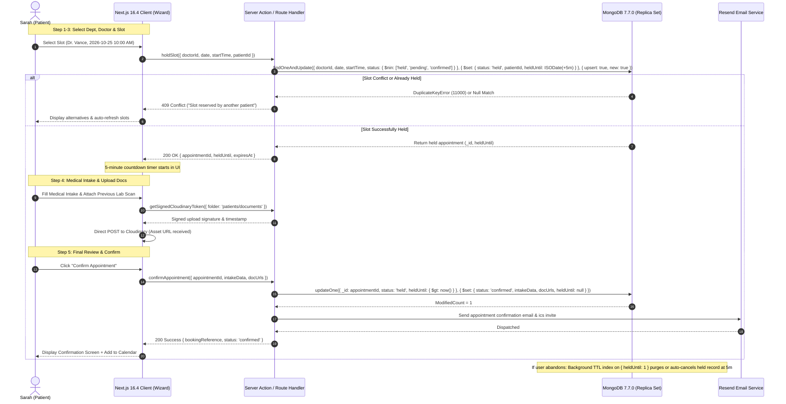
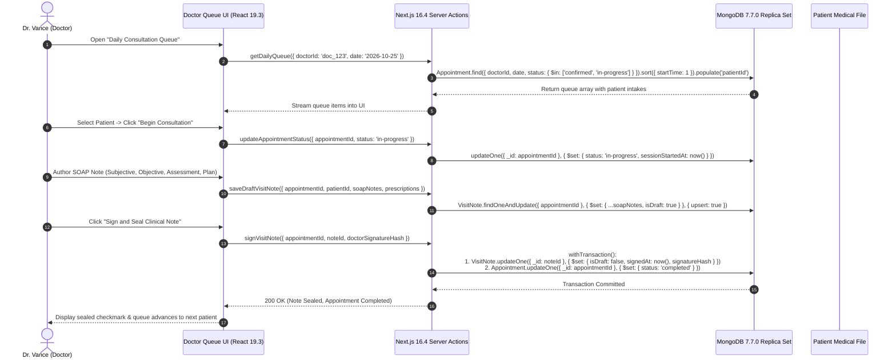
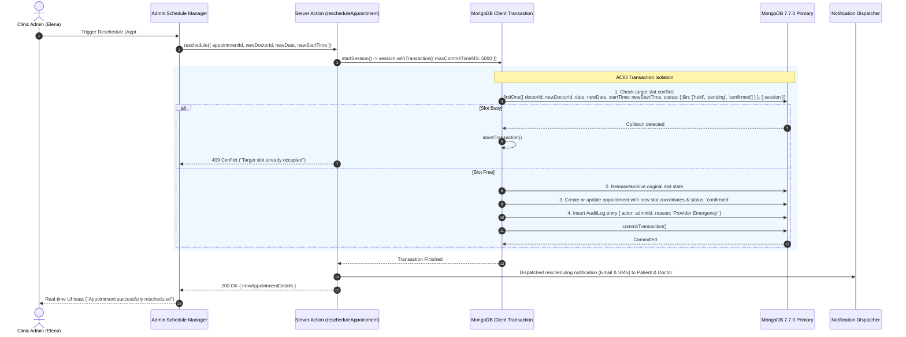
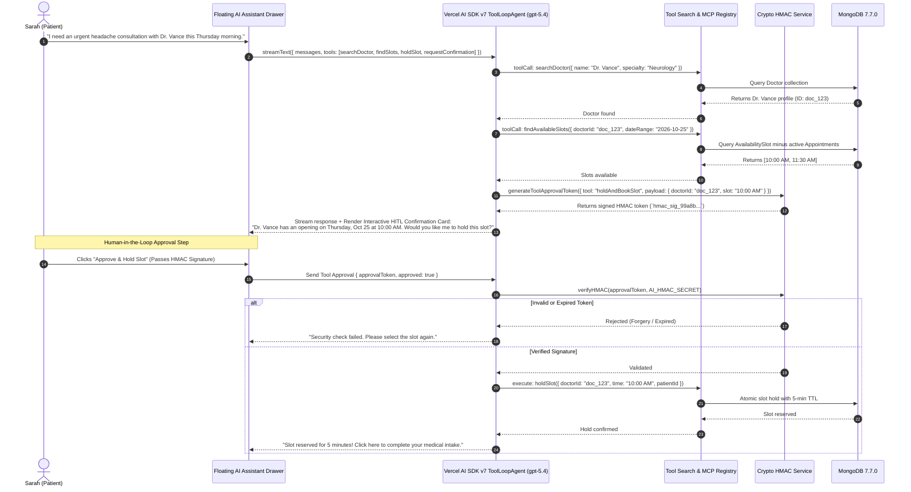

# Stakeholder Personas, Journeys & Clinical RBAC Matrix

## 1. Executive Summary & Clinical Context
The Digital Clinic & Appointment System provides an enterprise-grade outpatient consultation workflow connecting patients, clinical providers, healthcare administrators, and platform operations. Built upon Next.js 16.4.2, MongoDB 7.7.0, Mongoose 9.11.3, and Vercel AI SDK v7, this architecture satisfies strict healthcare data separation, concurrency-safe booking guarantees, and frictionless clinical administration.

---

## 2. Core Stakeholder Personas

### Persona 1: Patient (`patient`)
* **Demographics**: Sarah Jenkins, 42, Working Parent with chronic migraine & family health duties.
* **Clinical Goals**:
  - Quickly find specialized physicians by department, insurance acceptance, and clinical ratings.
  - Reserve appointments without phone tag or double-booking uncertainty.
  - Safely upload prior medical history (PDFs, MRI scans, lab results) via Cloudinary direct signed uploads.
  - Interact with an empathetic AI Clinical Receptionist for conversational slot discovery and triage.
* **Pain Points**:
  - Losing a slot mid-checkout due to race conditions with other patients.
  - Lack of visibility into queue wait times and appointment confirmation status.
  - Cumbersome authentication flows on mobile devices.

### Persona 2: Doctor / Healthcare Provider (`doctor`)
* **Demographics**: Dr. Marcus Vance, MD, Board-Certified Neurologist.
* **Clinical Goals**:
  - Access an uninterrupted daily schedule queue with live patient arrival status.
  - Author and seal Visit Notes (SOAP notes: Subjective, Objective, Assessment, Plan) immediately post-consultation.
  - Define granular recurring availability patterns and temporary blackout windows without administrative bottlenecks.
* **Pain Points**:
  - Overbooking and ghost bookings (no-shows).
  - High friction in electronic health records UI when charting notes between patient visits.
  - Security concerns regarding unauthorized staff viewing confidential physician diagnostic notes.

### Persona 3: Clinic Administrator (`admin`)
* **Demographics**: Elena Rostova, Practice Manager overseeing 18 physicians across 4 departments.
* **Clinical Goals**:
  - Rebalance provider schedules during emergency sick leaves via atomic multi-appointment reschedule transactions.
  - Monitor daily clinic throughput, no-show rates, and departmental utilization in real time.
  - Triage patient disputes, manual check-ins, and override appointment states with full audit logging.
* **Pain Points**:
  - Phantom writes and split-brain slot conflicts during bulk rescheduling.
  - Difficulty managing provider coverage across cross-functional departments.

### Persona 4: Platform Superadmin (`superadmin`)
* **Demographics**: Alex Chen, Lead DevOps & Security Engineer.
* **Clinical Goals**:
  - Maintain zero-downtime MongoDB replica set operations, TTL index hygiene, and CSFLE compliance.
  - Oversee Better Auth access controls, session revocation, and security audit log streams.
  - Inspect AI SDK v7 runtime token budgets, HMAC verification failures, and MCP server health.
* **Pain Points**:
  - Unaudited privilege escalation.
  - Stale slot leaks exhausting database memory.

---

## 3. Strict Role-Based Access Control (RBAC) Matrix

| Resource & Operation | `patient` | `doctor` | `admin` | `superadmin` | Security Constraint |
| :--- | :---: | :---: | :---: | :---: | :--- |
| **Browse Doctor Directory & Reviews** | ✅ Read | ✅ Read | ✅ Read | ✅ Read | Cached via Next.js 16.4 `"use cache"` |
| **Create 5-min Held Slot (`POST /api/appointments/hold`)** | ✅ Own | ❌ | ✅ Any | ✅ Any | Atomic compound unique index check |
| **Confirm Held Appointment (`POST /api/appointments/confirm`)** | ✅ Own | ❌ | ✅ Any | ✅ Any | Requires valid session + held state |
| **Cancel Appointment** | ✅ Own (>24h) | ✅ Assigned | ✅ Any | ✅ Any | Releases slot; triggers audit event |
| **Atomic Reschedule (`POST /api/appointments/reschedule`)** | ❌ | ❌ | ✅ Any | ✅ Any | Enforces `connection.withTransaction()` |
| **View Daily Provider Queue** | ❌ | ✅ Own Queue | ✅ All | ✅ All | Filtered by `doctorId` and current date |
| **Author / Sign Visit Note (SOAP)** | ❌ | ✅ Assigned | ❌ | ❌ | Immutable once status changed to `signed` |
| **Read Visit Note** | ✅ Own Note | ✅ Assigned | ✅ Read-only | ✅ Read-only | Encrypted payload; HIPAA/GDPR audit log |
| **Manage Provider Availability** | ❌ | ✅ Own Slots | ✅ All | ✅ All | Mutates `AvailabilitySlot` collection |
| **AI Receptionist Slot Search & Hold** | ✅ Own Session | ❌ | ❌ | ❌ | HMAC human-in-the-loop confirmation |
| **Direct Cloudinary Document Upload** | ✅ Own (Docs) | ✅ Own (Avatar) | ✅ Any | ✅ Any | Signed upload preset with strict mime types |
| **User & Role Management** | ❌ | ❌ | ❌ | ✅ Full CRUD | Better Auth `createAccessControl` guard |

---

## 4. Architectural Mermaid Sequence Diagrams

### (a) Patient 5-Step Booking with 5-Minute MongoDB TTL Hold

---

### (b) Doctor Daily Queue & Visit Note Publishing

---

### (c) Admin Atomic Replica-Set Reschedule

---

### (d) AI Receptionist Multi-Turn Slot Lookup and HMAC-Signed Human-In-The-Loop Booking Confirmation

