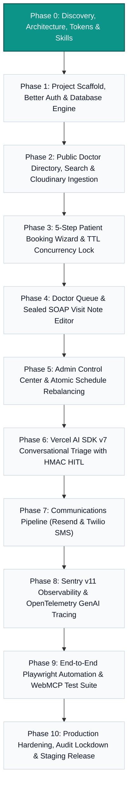

# Product Scope & MoSCoW Prioritization Matrix

## 1. Scope Governance Strategy
To deliver an enterprise-grade, concurrency-resilient healthcare system on schedule, project deliverables across Phases 1 through 10 are organized according to the MoSCoW methodology (Must-Have, Should-Have, Could-Have, Won't-Have). Strict boundaries prevent scope creep and ensure non-negotiable clinical safety, ACID transactions, and sub-second booking latencies.

---

## 2. MoSCoW Prioritization Matrix

| Category | Feature / Capability | Target Phase | Architecture & Tech Rationale |
| :--- | :--- | :---: | :--- |
| **MUST-HAVE** | **5-Minute Concurrency-Safe Slot Reservation** | Phase 1 & 2 | MongoDB TTL index (`heldUntil: 1`, `expireAfterSeconds: 0`) + partial compound unique index `{ doctorId: 1, date: 1, startTime: 1 }`. Prevents double-booking. |
| **MUST-HAVE** | **Provider Daily Queue & SOAP Note Publisher** | Phase 3 | Immutable clinical visit note sealing with cryptographic physician signature hash. Mongoose 9.11 transaction. |
| **MUST-HAVE** | **Better Auth 1.7 RBAC Engine** | Phase 1 | Role enforcement (`patient`, `doctor`, `admin`, `superadmin`), Google One Tap OAuth, and passwordless authentication. |
| **MUST-HAVE** | **Admin Atomic Multi-Slot Reschedule** | Phase 4 | MongoDB 7.7.0 `connection.withTransaction()` with `maxCommitTimeMS: 5000` to prevent partial schedule corruption. |
| **MUST-HAVE** | **Vercel AI SDK v7 Receptionist with HITL** | Phase 5 | `ToolLoopAgent` using OpenAI `gpt-5.4` with HMAC-signed Human-in-the-Loop tool confirmation cards. |
| **MUST-HAVE** | **Cloudinary Direct Signed Medical Ingestion** | Phase 2 | Zero-server-bandwidth file intake for patient documents (PDF/DICOM/JPG) using signed upload presets. |
| **MUST-HAVE** | **Resend Email Transactional Dispatch** | Phase 2 | Instant calendar invites (`.ics`) and booking confirmations. |
| **MUST-HAVE** | **Tailwind CSS v4 & shadcn Design Tokens** | Phase 0 & 1 | OKLCH color palettes, WCAG 2.2 AA compliant contrast (>= 4.5:1), and semantic clinical status badges. |
| **SHOULD-HAVE** | **Instant Doctor & Department Search with "use cache"** | Phase 2 | Next.js 16.4.2 Cache Components with `cacheTag('doctor-directory')` and tag revalidation on profile updates. |
| **SHOULD-HAVE** | **Optimistic Patient Queue Live Tracker** | Phase 4 | Polling / SSE fallback for live position updates in the outpatient waiting room. |
| **SHOULD-HAVE** | **Doctor Availability Exception Overrides** | Phase 3 | Specific date blackout ranges overriding default weekly recurring schedule slots. |
| **SHOULD-HAVE** | **Comprehensive Audit Logging** | Phase 4 | Immutable administrative audit trails for HIPAA/GDPR clinical change traceability. |
| **COULD-HAVE** | **Twilio SMS Notification Gateway** | Phase 6 | SMS dispatch fallback when patient email deliverability is impaired (`ENABLE_TWILIO_SMS="true"`). |
| **COULD-HAVE** | **Client-Side Field Level Encryption (CSFLE)** | Phase 7 | MongoDB CSFLE / Queryable Encryption for social security numbers and sensitive diagnostic codes. |
| **COULD-HAVE** | **Doctor Audio SOAP Dictation with AI Transcription** | Phase 8 | Real-time speech-to-text ambient clinical note generation using Whisper / Gemini multimodal input. |
| **WON'T-HAVE (V1)** | **Integrated Stripe Healthcare Billing & Co-Pay** | Phase 11+ | Deferred to V2. Out-of-pocket / insurance verification handled via reception desk in V1. |
| **WON'T-HAVE (V1)** | **WebRTC Live Telemedicine Video Rooms** | Phase 11+ | Deferred to V2. Focus of V1 is physical outpatient clinic scheduling and triage. |
| **WON'T-HAVE (V1)** | **Multi-Tenant Enterprise Hospital Networks** | Phase 11+ | Deferred to V2. V1 focuses on single-clinic multi-department operations. |

---

## 3. Phase-by-Phase Roadmap (Phases 1–10)

---

## 4. Architectural Guardrails & Acceptance Criteria
1. **Zero Double-Bookings**: Tested under synthetic concurrent booking loads of 50 simultaneous requests competing for identical slot coordinates.
2. **Sub-200ms Slot Discovery**: Cache hits on provider listings and availability queries utilizing Next.js 16.4 cache primitives.
3. **Sealed Note Integrity**: No clinical note can be altered after the cryptographic signature timestamp is committed to MongoDB.
4. **Human-in-the-Loop AI Action Safety**: The conversational agent cannot commit a booking or cancel an appointment without client-side cryptographic HMAC token approval.
