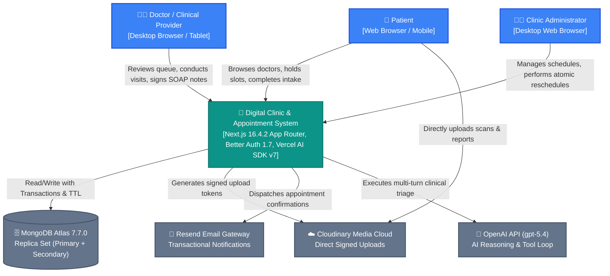
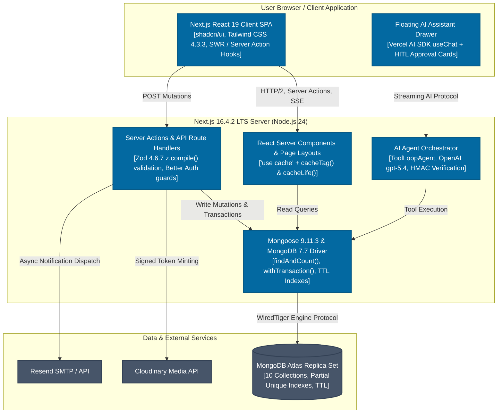
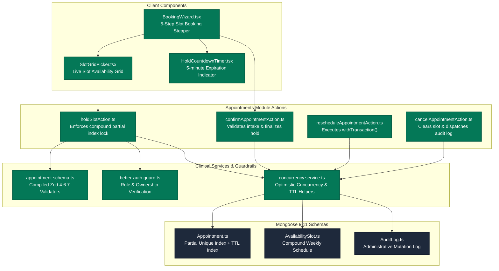

# Multi-Perspective Architecture Specification & C4 Architecture Decision Records (ADR)

## 1. Multi-Perspective Architectural Evaluation & Decision Records

### ADR 001: Monorepo vs Single Modular Next.js 16.4.2 Repository
* **Status**: Accepted & Locked.
* **Context**: The system must support simultaneous development across frontend UI components, backend Mongoose database mutations, Better Auth flows, AI SDK agents, and end-to-end Playwright tests without merge bottlenecks or tooling overhead.
* **Multi-Perspective Analysis**:
  - *Perspective A (Turborepo / Monorepo)*: Offers package separation (`/apps/web`, `/packages/db`, `/packages/ui`), but incurs build orchestration overhead, dual TypeScript compiler discrepancies, and high friction for subagent branch worktrees.
  - *Perspective B (Modular Monolith in Next.js 16.4.2 App Router)*: Colocates domain modules (`src/modules/{appointments, doctors, auth, ai, clinical}`) within a single high-performance compilation context. Leverages Next.js 16.4 native route handlers, Server Actions, and React Server Components.
* **Decision**: Adopt a Single Next.js 16.4.2 Modular Architecture utilizing feature-based directory structures (`src/modules/*`).
* **Consequences**:
  - Unifies dependencies into a single root `pnpm-lock.yaml`.
  - Dramatically accelerates Antigravity multi-agent `/teamwork-preview` execution within isolated Git worktrees.
  - TypeScript 7.0 native Go compiler (`tsgo`) achieves sub-second incremental typecheck passes across the entire codebase.

---

### ADR 002: Hybrid Concurrency Control Architecture
* **Status**: Accepted & Locked.
* **Context**: Clinical appointment scheduling suffers from two distinct concurrency hazards:
  1. *Patient Race Conditions*: Multiple patients attempting to reserve the exact same provider time slot concurrently.
  2. *Admin Schedule Realignment*: Moving existing confirmed appointments or batch rescheduling during emergency provider sick leave.
* **Multi-Perspective Analysis**:
  - *Approach 1 (Pessimistic Distributed Mutex via Redis)*: Introduces an external stateful dependency (Redis / Upstash KV), increasing infrastructure cost and failure modes.
  - *Approach 2 (Full ACID Multi-Document Transactions on Every Write)*: Incurs higher latency and connection pool pressure on initial high-throughput checkout workflows.
  - *Approach 3 (Hybrid Concurrency Model)*:
    - **Tier 1 (Initial Checkout Lock)**: 5-minute MongoDB TTL `status: 'held'` state enforced by a **Partial Unique Compound Index**:
      `{ doctorId: 1, date: 1, startTime: 1 }` where `status: { $in: ['held', 'pending', 'confirmed'] }`.
      Coupled with Mongoose 9.11 `optimisticConcurrency: true` (`__v` version key).
    - **Tier 2 (Admin Rescheduling & Visit Sealing)**: MongoDB 7.7.0 `connection.withTransaction()` with `maxCommitTimeMS: 5000` for multi-document atomic swap operations.
* **Decision**: Implement the Hybrid Concurrency Control Model.
* **Consequences**:
  - Zero double-booking vulnerability at the database engine level without requiring external Redis instances.
  - Automatic reclamation of abandoned holds via MongoDB background TTL index thread (`expireAfterSeconds: 0`).
  - Strict ACID guarantees for administrative reschedules and clinical note seals.

---

## 2. C4 Model Diagrams

### C4 Level 1: System Context Diagram

---

### C4 Level 2: Container Diagram

---

### C4 Level 3: Component Diagram (Appointments Domain Module)

