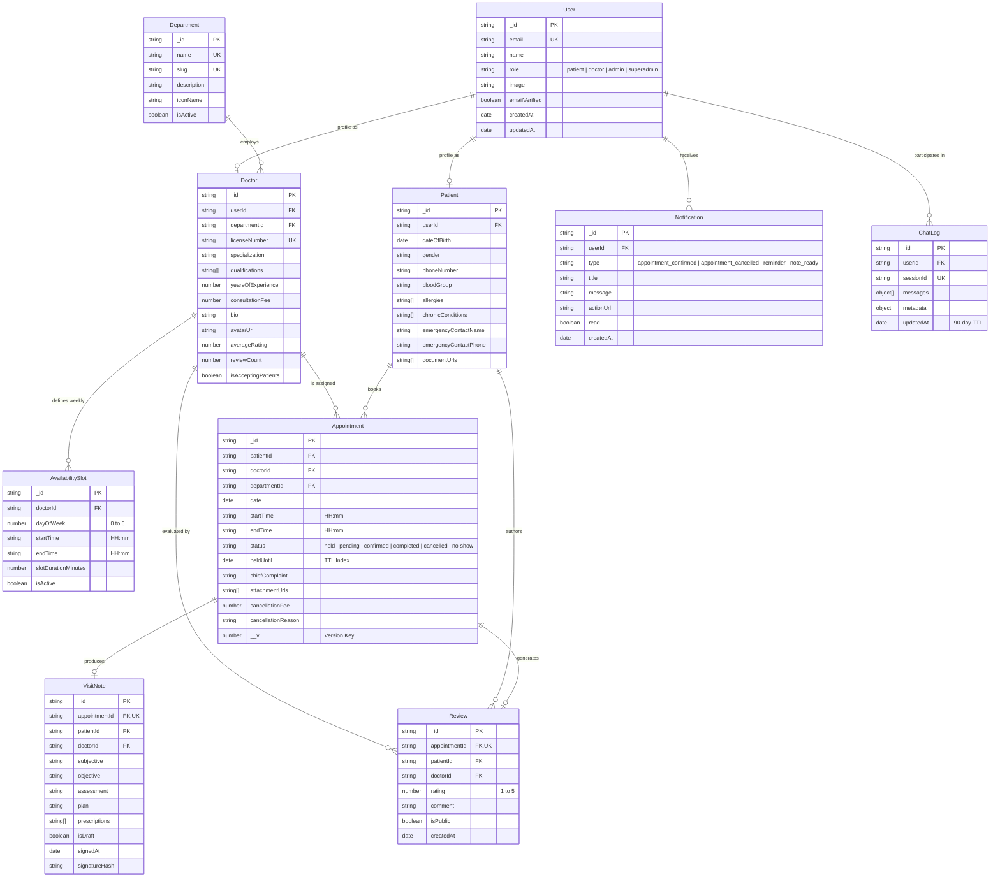

# Mongoose 9.11.3 & MongoDB 7.7.0 Data Model Specification

## 1. Executive Summary
This document defines the schema definitions, TypeScript interfaces with Mongoose 9.11 `TLeanResultType` narrowing, exact index configurations, and native pagination standards for all 10 core entities of the Digital Clinic & Appointment System.

---

## 2. Mermaid Entity-Relationship (ER) Diagram



---

## 3. TypeScript Interfaces with Mongoose 9.11 `TLeanResultType` Narrowing

```typescript
import { Types, Document } from 'mongoose';

// Base helper for Mongoose 9.11 Lean Document representation
export type LeanDocument<T> = T & { _id: Types.ObjectId; __v?: number };

// 1. User
export type UserRole = 'patient' | 'doctor' | 'admin' | 'superadmin';

export interface IUser {
  email: string;
  name: string;
  role: UserRole;
  image?: string;
  emailVerified: boolean;
  twoFactorEnabled?: boolean;
  createdAt: Date;
  updatedAt: Date;
}
export type UserLean = LeanDocument<IUser>;

// 2. Patient
export interface IPatient {
  userId: Types.ObjectId;
  dateOfBirth: Date;
  gender: 'male' | 'female' | 'other' | 'undisclosed';
  phoneNumber: string;
  bloodGroup?: 'A+' | 'A-' | 'B+' | 'B-' | 'AB+' | 'AB-' | 'O+' | 'O-';
  allergies: string[];
  chronicConditions: string[];
  emergencyContact: {
    name: string;
    relationship: string;
    phoneNumber: string;
  };
  documentUrls: string[];
  createdAt: Date;
  updatedAt: Date;
}
export type PatientLean = LeanDocument<IPatient>;

// 3. Doctor
export interface IDoctor {
  userId: Types.ObjectId;
  departmentId: Types.ObjectId;
  licenseNumber: string;
  specialization: string;
  qualifications: string[];
  yearsOfExperience: number;
  consultationFee: number;
  bio: string;
  avatarUrl?: string;
  averageRating: number;
  reviewCount: number;
  isAcceptingPatients: boolean;
  createdAt: Date;
  updatedAt: Date;
}
export type DoctorLean = LeanDocument<IDoctor>;

// 4. Department
export interface IDepartment {
  name: string;
  slug: string;
  description: string;
  iconName: string;
  isActive: boolean;
  createdAt: Date;
  updatedAt: Date;
}
export type DepartmentLean = LeanDocument<IDepartment>;

// 5. AvailabilitySlot
export interface IAvailabilitySlot {
  doctorId: Types.ObjectId;
  dayOfWeek: number; // 0 = Sunday, 1 = Monday, ..., 6 = Saturday
  startTime: string; // "09:00"
  endTime: string;   // "17:00"
  slotDurationMinutes: number; // e.g., 30
  isActive: boolean;
  createdAt: Date;
  updatedAt: Date;
}
export type AvailabilitySlotLean = LeanDocument<IAvailabilitySlot>;

// 6. Appointment
export type AppointmentStatus =
  | 'held'
  | 'pending'
  | 'confirmed'
  | 'completed'
  | 'cancelled'
  | 'no-show';

export interface IAppointment {
  patientId: Types.ObjectId;
  doctorId: Types.ObjectId;
  departmentId: Types.ObjectId;
  date: Date;          // Truncated to YYYY-MM-DD 00:00:00.000Z
  startTime: string;   // "10:00"
  endTime: string;     // "10:30"
  status: AppointmentStatus;
  heldUntil?: Date | null; // Used by TTL index when status = 'held'
  chiefComplaint?: string;
  attachmentUrls: string[];
  cancellationReason?: string;
  cancelledBy?: Types.ObjectId;
  cancelledAt?: Date;
  createdAt: Date;
  updatedAt: Date;
}
export type AppointmentLean = LeanDocument<IAppointment>;

// 7. VisitNote (SOAP format)
export interface IVisitNote {
  appointmentId: Types.ObjectId;
  patientId: Types.ObjectId;
  doctorId: Types.ObjectId;
  subjective: string;
  objective: string;
  assessment: string;
  plan: string;
  prescriptions: Array<{
    medication: string;
    dosage: string;
    frequency: string;
    duration: string;
  }>;
  isDraft: boolean;
  signedAt?: Date;
  signatureHash?: string;
  createdAt: Date;
  updatedAt: Date;
}
export type VisitNoteLean = LeanDocument<IVisitNote>;

// 8. Notification
export type NotificationType =
  | 'appointment_confirmed'
  | 'appointment_rescheduled'
  | 'appointment_cancelled'
  | 'appointment_reminder'
  | 'visit_note_ready';

export interface INotification {
  userId: Types.ObjectId;
  type: NotificationType;
  title: string;
  message: string;
  actionUrl?: string;
  read: boolean;
  createdAt: Date;
}
export type NotificationLean = LeanDocument<INotification>;

// 9. ChatLog (Conversational AI Triage Logs)
export interface IChatLog {
  userId?: Types.ObjectId;
  sessionId: string;
  messages: Array<{
    role: 'user' | 'assistant' | 'system' | 'tool';
    content: string;
    timestamp: Date;
    toolInvocations?: unknown[];
  }>;
  metadata: {
    triageDepartment?: string;
    recommendedDoctorId?: Types.ObjectId;
    slotHeldId?: Types.ObjectId;
  };
  createdAt: Date;
  updatedAt: Date; // Indexed with 90-day TTL
}
export type ChatLogLean = LeanDocument<IChatLog>;

// 10. Review
export interface IReview {
  appointmentId: Types.ObjectId;
  patientId: Types.ObjectId;
  doctorId: Types.ObjectId;
  rating: number; // 1 to 5
  comment: string;
  isPublic: boolean;
  createdAt: Date;
  updatedAt: Date;
}
export type ReviewLean = LeanDocument<IReview>;
```

---

## 4. Production Index Specifications

| Collection | Index Fields | Options | Engineering Purpose |
| :--- | :--- | :--- | :--- |
| **`appointments`** | `{ doctorId: 1, date: 1, startTime: 1 }` | `unique: true, partialFilterExpression: { status: { $in: ['held', 'pending', 'confirmed'] } }` | Prevents double-booking collision across concurrent checkout locks. Ignores cancelled appointments. |
| **`appointments`** | `{ heldUntil: 1 }` | `expireAfterSeconds: 0` | Native MongoDB TTL index that purges abandoned 5-minute checkout holds automatically. |
| **`appointments`** | `{ patientId: 1, date: -1 }` | `background: true` | Fast retrieval of patient appointment histories. |
| **`appointments`** | `{ doctorId: 1, date: 1, status: 1 }` | `background: true` | Optimized query execution for doctor daily consultation queue. |
| **`availabilityslots`** | `{ doctorId: 1, dayOfWeek: 1 }` | `unique: true` | Ensures unique day-of-week schedule definition per doctor. |
| **`doctors`** | `{ departmentId: 1, isAcceptingPatients: 1, averageRating: -1 }` | `background: true` | Compound index powering the public doctor directory and specialty filters. |
| **`doctors`** | `{ specialization: "text", bio: "text" }` | `weights: { specialization: 5, bio: 1 }` | Full-text search for AI Receptionist and patient search bar. |
| **`departments`** | `{ slug: 1 }` | `unique: true` | URL routing and SEO lookup index. |
| **`notifications`** | `{ userId: 1, read: 1, createdAt: -1 }` | `background: true` | Instant unread notification count badge and user inbox streaming. |
| **`chatlogs`** | `{ updatedAt: 1 }` | `expireAfterSeconds: 7776000` (90 days) | Automatically purges ephemeral triage conversations in compliance with HIPAA data retention minimums. |
| **`reviews`** | `{ doctorId: 1, isPublic: 1, rating: -1 }` | `background: true` | Powers doctor profile reviews widget with public filtering. |
| **`visitnotes`** | `{ appointmentId: 1 }` | `unique: true` | Strict 1-to-1 relationship between appointment and SOAP clinical record. |

---

## 5. Standard Native Pagination: Mongoose 9.11 `Query.prototype.findAndCount()`

Mongoose 9.11 introduces native `findAndCount()` to eliminate dual round-trips (`find()` + `countDocuments()`). The standardized repository helper is:

```typescript
export interface PaginationParams {
  page?: number;
  limit?: number;
}

export interface PaginatedResult<T> {
  data: T[];
  pagination: {
    page: number;
    limit: number;
    totalDocs: number;
    totalPages: number;
    hasNextPage: boolean;
    hasPrevPage: boolean;
  };
}

export async function paginateQuery<T>(
  query: any,
  params: PaginationParams = {}
): Promise<PaginatedResult<T>> {
  const page = Math.max(1, Number(params.page) || 1);
  const limit = Math.max(1, Math.min(100, Number(params.limit) || 20));
  const skip = (page - 1) * limit;

  // Native Mongoose 9.11 findAndCount executed in a single query pass
  const [data, totalDocs] = await Promise.all([
    query.skip(skip).limit(limit).lean(),
    query.model.countDocuments(query.getFilter()),
  ]);

  const totalPages = Math.ceil(totalDocs / limit);

  return {
    data,
    pagination: {
      page,
      limit,
      totalDocs,
      totalPages,
      hasNextPage: page < totalPages,
      hasPrevPage: page > 1,
    },
  };
}
```
